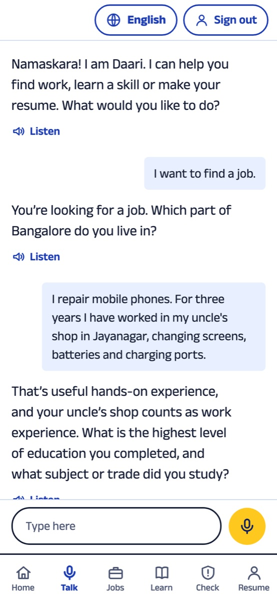
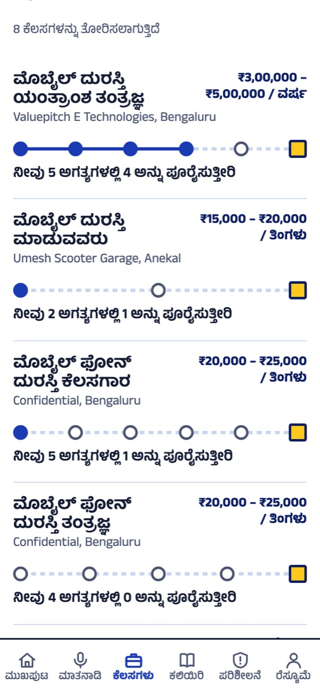

# Daari

*Daari* (ದಾರಿ) means "the way" in Kannada.

Bangalore has plenty of skilled work, and plenty of people who can do it: ITI and diploma holders, non-CS graduates, and people who learned a trade in a relative's shop. Most of them meet the job market through English-first portals that want a resume they don't have, use job titles they don't recognise, and give no reason for a rejection. Job scams aimed at exactly these people are common on WhatsApp and Telegram.

Daari is a career counsellor you talk to in Kannada, Hindi or English. It asks about the work you have done, informal work included, and gives you a short plan. It finds jobs that fit and shows which requirements you already meet. It teaches the ones you don't, writes a resume from what you said, and checks job messages for the signs of a scam.

**Live:** https://145-223-23-79.sslip.io

<table>
  <tr>
    <td></td>
    <td></td>
    <td></td>
  </tr>
  <tr>
    <td align="center">Start by talking or typing</td>
    <td align="center">The counsellor asks one thing at a time</td>
    <td align="center">A plan, built from what you said</td>
  </tr>
</table>

## Try it

Open the live site and sign in with one of these test numbers. They are set up in Firebase, so no SMS is sent. Type the code when it asks.

| Number | Code |
|---|---|
| 8888888888 | 101010 |
| 7777777777 | 111111 |

Each number is its own account. Other people may be using them too, so "Delete my information" on the Resume tab gives you a clean start. [TESTING.md](TESTING.md) has a full walk-through as Ravi, a phone repair worker, in English and Hindi.

## What it does

### Talk, then a plan

The first screen asks one question: where do you want to start? You can look for a job, learn a skill, make a resume, or say you're not sure yet. Tap the mic and speak, or type. Speech is transcribed in whatever mix of languages you actually use, and every reply can be read aloud.

The counsellor asks one question at a time and counts informal work as work. Three years fixing phones at an uncle's shop is experience, and it says so. Once it has enough, a fast yes/no check decides the conversation is ready, and Daari hands over a plan. The plan says what Daari understood about you, then gives two to four steps, each with a button that goes to the right screen, and ends at the work you're aiming for. If the summary gets something wrong, tell Daari, then tap **Make a new plan** on Home.

### Jobs, with the route to each one

<table>
  <tr>
    <td></td>
    <td></td>
    <td></td>
  </tr>
  <tr>
    <td align="center">Ranked by fit</td>
    <td align="center">Every requirement, checked</td>
    <td align="center">Everything in Kannada or Hindi too</td>
  </tr>
</table>

Each job shows its requirements as stops on a bus route. A filled stop is one you already meet, judged from your own words, and the yellow square at the end is the job. "You meet 4 of 5" is a count you can check stop by stop, not a made-up match percentage. If Daari is unsure about a stop, you can tell it "yes, I have this" and the count updates.

You can sort by best fit, eligibility, pay, or road distance from your area, and filter by pay and distance. Listings that ask for money or sensitive details sink to the bottom with a warning.

Many small shops never post vacancies online. **Places to ask** finds local businesses in your trade and area, and writes a WhatsApp message and a call script for asking in person. These are labelled as places to ask, not confirmed vacancies.

### Apply

For any job, Daari prepares a message to the employer (with what it says in your language), a call script, the documents to carry, and likely interview questions. You can answer a question out loud and hear what was good and what to improve. You always send the application yourself. Daari then keeps a list of where you applied and what happened.

### Learn

<table>
  <tr>
    <td></td>
    <td></td>
    <td></td>
  </tr>
  <tr>
    <td align="center">Learn what your jobs ask for</td>
    <td align="center">A resume you have checked</td>
    <td align="center">Check any job message</td>
  </tr>
</table>

Learn turns the requirements you don't meet yet into a short plan: what to learn, why it matters for these jobs, how long it takes, and one thing to practise. Each step links to a course from a hand-checked list of 23 NPTEL and SWAYAM courses, plus YouTube videos and playlists. Videos are searched in your language, then checked before they are shown: they must teach the skill, be in your language, and be a lesson rather than an advert. Very short or barely watched videos are left out. If you came to learn rather than to find a job, the plan starts from the work you said you want.

### Resume

The resume is written in English for employers, from what you told Daari or from an old resume you upload. Each line is checked against your own words, and any line your words don't support is removed. Before you can download the PDF, Daari lists every claim the resume makes, in your language, and you confirm they are all true. There are two layouts: work first, or skills first.

### Check a message

Paste or read out a job message from WhatsApp, Telegram or SMS. Daari names the specific warning signs, such as "asks you to pay money" or "moves you to WhatsApp", explains them in a sentence or two, and says what to do next.

## How it fits together

| Job | Tool |
|---|---|
| Speech to text, text to speech | Sarvam: `saaras:v3` (handles mixed Kannada, Hindi and English) and `bulbul:v3` |
| Conversation, plans, writing, translation | GPT-6 Luna through ZenMux, with GPT-6.1 Terra for resumes. IBM Bob's `premium` model is used instead when `IBM_BOB_API_KEY` is set. |
| Fast yes/no decisions: job fit, each requirement, scam signals, resume claims, when to make a plan, whether a video fits | Jev (TypeSafe), around 250ms per decision |
| Job listings | JSearch, prepared ahead of time into `data/jobs.json` (212 Bangalore listings) |
| Local businesses | Google Places, or a Google Maps search when no key is set |
| Road distances | Google Routes API |
| Learning videos | YouTube Data API |
| Sign-in | Firebase phone sign-in and Google sign-in, then a signed session cookie |
| Accounts | SQLite, through Node's built-in `node:sqlite` |
| Resume PDF | Fixed templates filled from JSON with `@react-pdf/renderer` |

The app is Next.js 16 with React 19 and TypeScript. All AI calls happen on the server, so no key reaches the browser.

Two rules shape most of the code:

- **Language models write, Jev decides.** A language model writes the replies, plans and resumes. Every yes/no judgement that changes what someone sees goes to Jev as a narrow, separately scored question. That covers "does this person meet this requirement?", "does this message ask for money?" and "is this video in Kannada?". Those answers are fast, consistent between runs, and can be tested one at a time.
- **Nothing the person didn't say.** Requirements count as met only on the person's own words. Resume lines without support are removed. Places to ask are never presented as vacancies.

## Project layout

```
app/                 Pages (Home, Talk, Jobs, Learn, Check, Resume, Sign in) and API routes under app/api
components/          Shared UI: the account state, the chat composer, the plan, the route line
lib/
  i18n.ts            Every string on screen, in English, Hindi and Kannada
  state.ts           The schemas for saved account data, shared by browser and server
  types.ts           Profile, job and plan types
  rank.ts, pay.ts    Job ranking and pay parsing
  client/            Browser helpers: API calls, audio playback, recording
  server/            Everything with a key: the language model, Jev, Sarvam, YouTube, Places, Routes,
                     prompts, job matching, sign-in, and the database
data/                The job catalog and the checked course list
scripts/             Catalog builder, scam evaluation, end-to-end browser run
deploy/              Deploy script, systemd units, Caddy config, database backups
tests/               Unit tests (vitest)
```

## Data

Accounts are kept in one SQLite file, through Node's built-in `node:sqlite`, so there is no database server or native module to install. `lib/server/db.ts` opens it and applies the migrations, `lib/server/store.ts` holds every query, and `lib/state.ts` has the schemas both the browser and the server check against.

- **One account's data only.** The account id comes from the signed session cookie (`phone:+91…` or `google:…`), and every query is scoped by it. Nothing the browser sends can choose the account.
- **Tables.** `users`, then `documents` (one JSON document per part of the account, such as `profile` or `plan`), `messages` (one row per message, in order) and `applications`. They are `STRICT`, check their JSON and allowed values, and are deleted with their account through foreign keys.
- **Saving.** The browser sends only what changed, a moment after it changes, with retries, and sends any pending save when the page is closed. Each save is one transaction. A message sent twice is stored once, and each account keeps its newest 1,000 messages. If two phones change the same part at once, the later save wins.
- **Migrations.** Each schema change is a new entry at the end of `MIGRATIONS`, applied in order on start and tracked in `PRAGMA user_version`. Never edit one that has shipped. The app refuses to start on a database written by newer code.
- **Deleting.** "Delete my information" removes the account and everything it owns.
- **Where it lives.** `DATABASE_PATH`, which production requires, so a deploy can never start from an empty file inside a release. Locally it defaults to `.data/daari.db`.
- **Backups.** The deploy script copies the database before every deploy and at least once a day, keeping a week of copies in `~/daari/backups`. To restore one, stop the app (`sudo systemctl stop daari`), copy the backup over `DATABASE_PATH`, delete any `-wal` and `-shm` files beside it, and start the app again.

Only the language choice is kept in the browser, for the screens before sign-in.

## Running it locally

You need Node 23 or newer, for `node:sqlite`, and pnpm.

```
pnpm install
cp .env.example .env    # then fill in the keys below
pnpm dev
```

Server-side keys:

```
ZENMUX_API_KEY=          # language model (or IBM_BOB_API_KEY to use IBM Bob)
JEV_API_KEY=
SARVAM_API_KEY=
X_RAPIDAPI_KEY=          # JSearch, only needed to refresh the job catalog
X_RAPIDAPI_HOST=jsearch.p.rapidapi.com
GOOGLE_PLACES_API_KEY=   # optional: real shops in Places to ask
GOOGLE_ROUTES_API_KEY=   # optional: road-distance sorting and filters
YOUTUBE_API_KEY=         # optional: real videos and playlists in learning plans
```

Every page needs sign-in, so `AUTH_SECRET` (at least 32 characters) and the Firebase keys in `.env.example` are needed too. Add test numbers under Firebase Console → Authentication → Sign-in method → Phone to sign in without SMS. Google sign-in stays hidden until `GOOGLE_SIGNIN=on`. Turn that on only after `GOOGLE_REDIRECT_URI` is added as an authorised redirect URI in Google Cloud. In production, `APP_BASE_URL` sets the public address that Google sign-in returns to.

| Command | What it does |
|---|---|
| `pnpm dev` | Runs the app at http://localhost:3000 |
| `pnpm test` | Runs the unit tests |
| `pnpm typecheck` | Checks types |
| `pnpm catalog` | Refreshes the job listings, using cached responses where it can |
| `pnpm scam-eval` | Runs the scam signals over hand-written examples and real listings |
| `node scripts/e2e.mjs <url> <screenshot dir> <wav>` | Drives the app in a browser with real APIs, using a WAV file as the microphone |

### Spending

Each server process stops calling the language model after `SPEND_LIMIT_USD` (default $11, about ₹1,000), counted at listed prices. Each API route also has a per-address rate limit. YouTube search results are cached for a day, which keeps the daily quota of about 100 searches enough for a demo.

### Road distances

Distances are fetched only after someone picks a distance filter or nearest-first sorting. A search checks at most 24 listings. Within one request, jobs are grouped by locality and each destination is sent once. The browser keeps the distances for the current page view, so changing the threshold or switching between sorting and filtering reuses them. They are not stored on the server or shared between people, because Google Maps Platform terms don't allow storing Routes results. They are approximate road distances between localities, not door to door. Keep the Routes key server-side, restricted to the Routes API, and limited to the server's IP address where possible.

### Pay

A pay filter keeps a job only when the listing's stated minimum monthly pay is above the chosen amount. Yearly pay is converted to monthly. Pay sorting uses the same minimum.

## Tests

`pnpm test` runs the unit tests: job matching and ranking, profile merging, road distances, the YouTube picker, and the account store. The store tests use a real SQLite file. They check that two accounts never see each other's data, that a resent message is saved once, and that deleting an account removes everything it owns and nothing else.

[TESTING.md](TESTING.md) is the manual test plan, written as one person's path through the app.

## Deployment

The live app runs on a VPS. It checks GitHub every minute, and a new commit on `main` goes live after its unit tests and build pass, usually within about 70 seconds. If the new version fails either step, or will not start, the site stays on the last working version.

The app runs as the `daari` service behind Caddy, from `~/daari/current`. Its keys are in `~/daari/shared/.env`, which is not in git, and changing them needs `sudo systemctl restart daari`. `~/daari/deploy.log` shows each deploy, `readlink ~/daari/current` shows which commit is live, and `journalctl -u daari -f` shows the app's logs. `deploy/` holds the deploy script, services and Caddy config.

## Known limits

- The job catalog is a snapshot. Run `pnpm catalog` to refresh it.
- A plan is written in the language you were using when it was made. Switching language changes the screens around it but not the plan's own text, until you make the plan again.
- The spending limit counts per server process, so it resets on each deploy. It is a safety net, not an account balance.
- If two phones signed in to one account change the same thing at the same moment, the later save wins.
- `spikes/` holds the throwaway scripts behind the early API and model choices. They are not part of the app.
