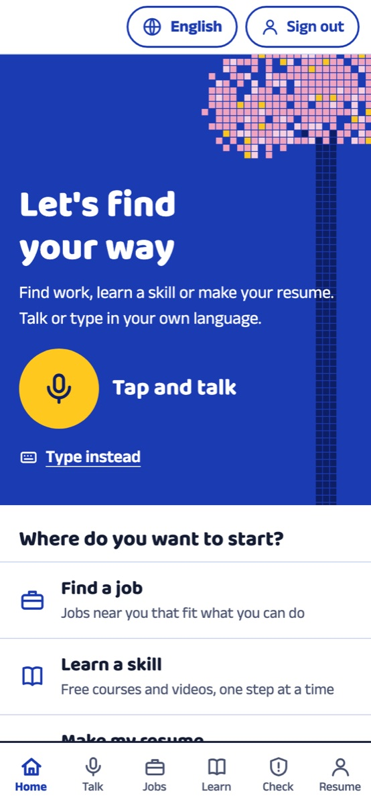
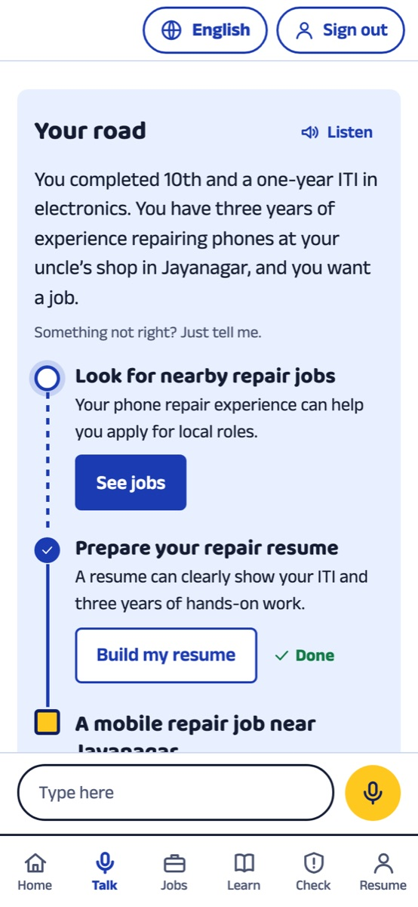
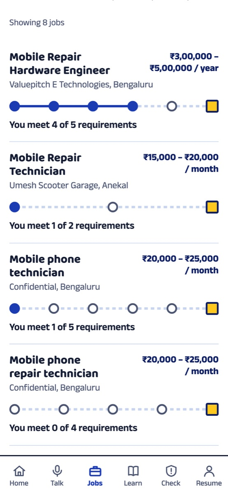
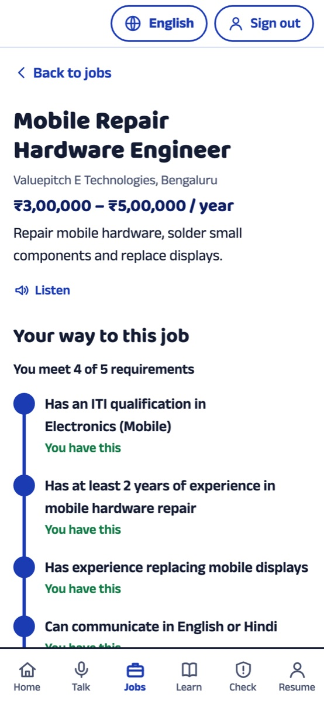
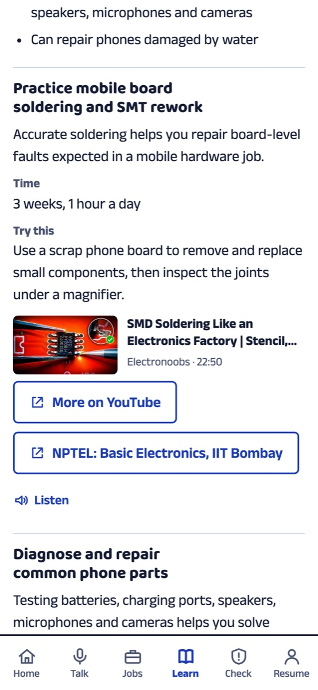
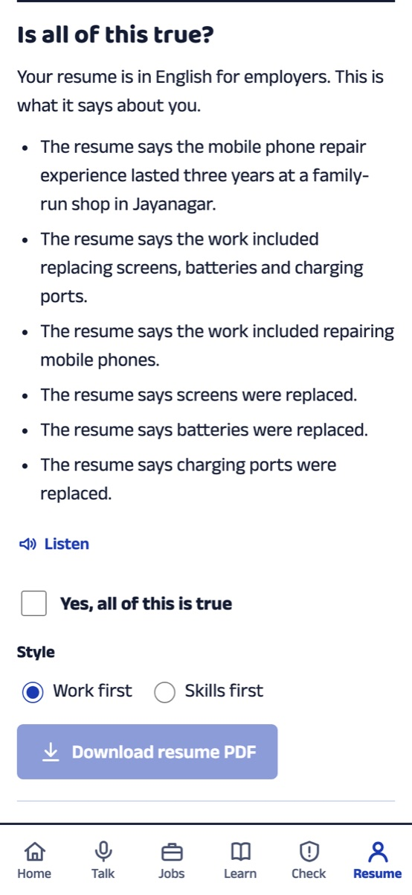
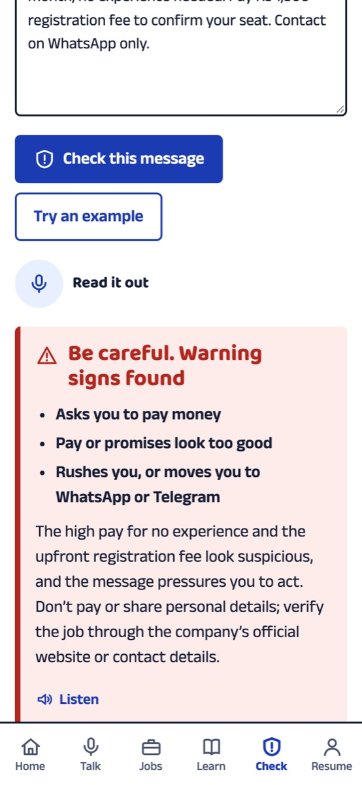
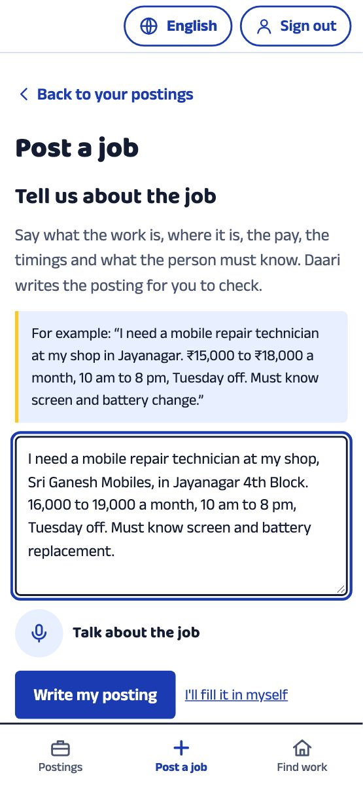
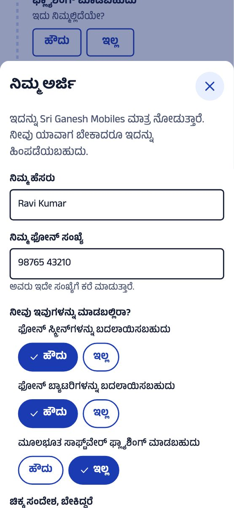
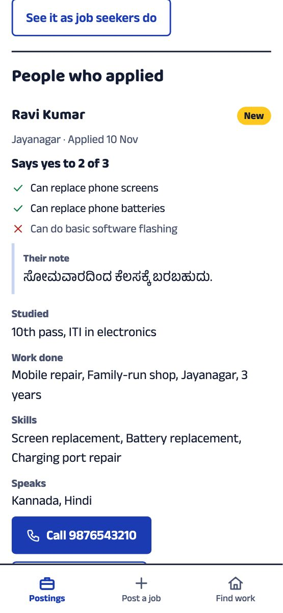

# Daari

*Daari* (ದಾರಿ) means "the way" in Kannada.

**[Live site](https://145-223-23-79.sslip.io)** · **[Problem statement and solution](docs/problem-and-solution.md)** · **[Run it locally](SETUP.md)** · **[Test plan](TESTING.md)**


Bangalore has plenty of skilled work, and plenty of people who can do it: ITI and diploma holders, non-CS graduates, and people who learned a trade in a relative's shop. Most of them meet the job market through English-first portals that want a resume they don't have, use job titles they don't recognise, and give no reason for a rejection. Job scams aimed at exactly these people are common on WhatsApp and Telegram.

Daari is a career counsellor you talk to in Kannada, Hindi or English. It asks about the work you have done, informal work included, and gives you a short plan. It finds jobs that fit and shows which requirements you already meet. It teaches the ones you don't, writes a resume from what you said, and checks job messages for the signs of a scam.

Small employers can post on Daari too. A shop owner describes the job by talking or typing in their own language. Daari writes the posting in all three languages and refuses any posting that charges applicants. People whose skills fit then apply inside Daari, and hear back there.

<table>
  <tr>
    <td></td>
    <td></td>
    <td></td>
  </tr>
  <tr>
    <td align="center">Start by talking or typing</td>
    <td align="center">The counsellor asks one thing at a time</td>
    <td align="center">A plan, built from what you said</td>
  </tr>
</table>

## Try it

Open the live site and sign in with your Google account. Your conversation, plan and applications are saved to that account. To start fresh, tap the person button in the top corner and choose **Start over**. The same button signs you out. [TESTING.md](TESTING.md) is a step-by-step test script: Ravi, a phone repair worker, finds and applies for a job, and a shop owner hires him.

## What it does

### Talk, then a plan

You start by picking Kannada, Hindi or English, each written in its own script, so nobody has to read English to sign in. The home screen then asks one question: where do you want to start? You can look for a job, learn a skill, make a resume, or say you're not sure yet. Tap the mic and speak, or type. Speech is transcribed in whatever mix of languages you actually use, and every reply can be read aloud.

The counsellor asks one question at a time and counts informal work as work. Three years fixing phones at an uncle's shop is experience, and it says so. Once it has enough, a fast yes/no check decides the conversation is ready, and Daari hands over a plan. The plan says what Daari understood about you, then gives two to four steps, each with a button that goes to the right screen, and ends at the work you're aiming for. If the summary gets something wrong, tell Daari, then tap **Make a new plan** on Home.

### Jobs, with the route to each one

<table>
  <tr>
    <td></td>
    <td></td>
    <td></td>
  </tr>
  <tr>
    <td align="center">Ranked by fit</td>
    <td align="center">Every requirement, checked</td>
    <td align="center">Everything in Kannada or Hindi too</td>
  </tr>
</table>

Each job shows its requirements as stops on a bus route. A filled stop is one you already meet, judged from your own words, and the yellow square at the end is the job. "You meet 4 of 5" is a count you can check stop by stop, not a made-up match percentage. If Daari is unsure about a stop, you can tell it "yes, I have this" and the count updates.

You can sort by best fit, eligibility, pay, or road distance from your area, and filter by pay and distance. Listings that ask for money or sensitive details sink to the bottom with a warning.

Many small shops never post vacancies online. **Places to ask** finds local businesses in your trade and area, and writes a WhatsApp message and a call script for asking in person. These are labelled as places to ask, not confirmed vacancies.

### Apply

For any job, Daari prepares a message to the employer (with what it says in your language), a call script, the documents to carry, and likely interview questions. You can answer a question out loud and hear what was good and what to improve. You always send the application yourself. Daari then keeps a list of where you applied and what happened.

### Learn

<table>
  <tr>
    <td></td>
    <td></td>
    <td></td>
  </tr>
  <tr>
    <td align="center">Learn what your jobs ask for</td>
    <td align="center">A resume you have checked</td>
    <td align="center">Check any job message</td>
  </tr>
</table>

Learn turns the requirements you don't meet yet into a short plan: what to learn, why it matters for these jobs, how long it takes, and one thing to practise. Each step links to a course from a hand-checked list of 23 NPTEL and SWAYAM courses, plus YouTube videos and playlists. Videos are searched in your language, then checked before they are shown: they must teach the skill, be in your language, and be a lesson rather than an advert. Very short or barely watched videos are left out. If you came to learn rather than to find a job, the plan starts from the work you said you want.

### Resume

The resume is written in English for employers, from what you told Daari or from an old resume you upload. Each line is checked against your own words, and any line your words don't support is removed. Before you can download the PDF, Daari lists every claim the resume makes, in your language, and you confirm they are all true. There are two layouts: work first, or skills first.

### Check a message

Paste or read out a job message from WhatsApp, Telegram or SMS. Daari names the specific warning signs, such as "asks you to pay money" or "moves you to WhatsApp", explains them in a sentence or two, and says what to do next.

### Hiring on Daari

<table>
  <tr>
    <td></td>
    <td></td>
    <td></td>
  </tr>
  <tr>
    <td align="center">The employer describes the job</td>
    <td align="center">A job seeker applies, in their language</td>
    <td align="center">The employer sees who applied, and calls</td>
  </tr>
</table>

Most of the jobs these people end up doing are in small shops and workshops that never post online. The sign-in page asks "Hiring for your shop or business?", and the same Google sign-in takes the employer to their own pages: their postings, a new posting, and a way back to finding work.

- **Posting.** The employer says what the job is, where, the pay, the timings and what the person must know. A language model turns that into a posting for them to check and correct: a title, what the work involves, pay and timings, and up to six requirements, each written so a job seeker can answer yes or no. Jev picks the kind of work, which decides who sees it. If none of the listed kinds fits, the employer types their own and Jev matches it to the nearest one. On publishing, the posting is translated into English, Hindi and Kannada, and the employer's own wording is kept as typed.
- **Screening.** Jev checks the employer's description, and again the final posting, for three things that stop it going up: asking applicants to pay (a fee, a deposit, a uniform), asking for an OTP, bank details, Aadhaar or PAN before an interview, and turning people away by caste, religion or community. If the description asked for money, the employer has to describe the job again, so a draft that quietly dropped the fee cannot be posted. Pay that looks too good for the work is a caution, not a block. On 100 test postings (50 honest, and the same 50 with a demand for money added), it blocked all 50 that asked for money and none of the honest ones. Honest postings scored 0.05 to 0.12 and the others 0.92 to 0.97, against a cut-off of 0.6, with a median of 263 ms per check. `pnpm posting-eval` reruns it.
- **Finding it.** Open postings join the catalog in matching, so they get the same fit check and the same route of requirements as any other job. Among jobs that fit equally well, one posted on Daari comes first, marked with a yellow **Apply on Daari** tag. Saved matches refresh whenever an employer posts, changes or closes a job. An employer can share a posting on WhatsApp. Someone who opens the link and is not signed in comes back to the job after signing in.
- **Applying.** The person answers each requirement yes or no themselves, starting from what they have already told Daari (Daari never guesses a "no" for them), and adds a phone number and a note if they want. Before sending, they see exactly what the employer will get: name, phone, area, education, work done, skills and languages. That copy goes to that one employer only. They can take it back at any time, and then the employer no longer sees any of it.
- **Hearing back.** The employer sees each applicant with their answers, can call them or send a WhatsApp message (written in the applicant's language), and can mark them shortlisted, not a fit or hired. The applicant sees, in words, where they stand: not looked at yet, seen, interested ("keep your phone close"), someone else chosen, or picked. Most job portals never tell people this.
- **Keeping it clean.** A posting lasts 30 days, then the employer renews it if they are still hiring. Closing takes it out of every list at once. One account can have 10 open postings, and the same job cannot be open twice. Job seekers can report a posting, and reports from three different people take it down.

## How it fits together

| Job | Tool |
|---|---|
| Speech to text, text to speech | Sarvam: `saaras:v3` (handles mixed Kannada, Hindi and English) and `bulbul:v3` |
| Conversation, plans, writing, translation | IBM Bob's `premium` model. If Bob returns an error, an unusable reply or no reply in time, the same request goes to GPT-6 Luna through ZenMux (GPT-6.1 Terra for resumes), and Bob is skipped for a minute. `pnpm llm-smoke` shows which one answered. |
| Fast yes/no decisions: job fit, each requirement, scam signals, whether a posting may go up and its kind of work, resume claims, when to make a plan, whether a video fits | Jev (TypeSafe), around 250ms per decision |
| Job listings | JSearch, prepared ahead of time into `data/jobs.json` (222 Bangalore listings, last refreshed on 16 November 2026), plus the jobs employers post on Daari |
| Local businesses | Google Places, or a Google Maps search when no key is set |
| Road distances | Google Routes API |
| Learning videos | YouTube Data API |
| Sign-in | Google sign-in, then a signed session cookie |
| Accounts | SQLite, through Node's built-in `node:sqlite` |
| Resume PDF | Fixed templates filled from JSON with `@react-pdf/renderer` |

The app is Next.js 16 with React 19 and TypeScript. All AI calls happen on the server, so no key reaches the browser.

Two rules shape most of the code:

- **Language models write, Jev decides.** A language model writes the replies, plans and resumes. Every yes/no judgement that changes what someone sees goes to Jev as a narrow, separately scored question. That covers "does this person meet this requirement?", "does this message ask for money?" and "is this video in Kannada?". Those answers are fast, consistent between runs, and can be tested one at a time.
- **Nothing the person didn't say.** Requirements count as met only on the person's own words. Resume lines without support are removed. Places to ask are never presented as vacancies.

## Project layout

```
app/                 Pages (Home, Talk, Jobs, Learn, Check, Resume, Sign in, and the employer pages
                     under /employer) and API routes under app/api
components/          Shared UI: the account state, the chat composer, the plan, the route line
lib/
  i18n.ts            Every string on screen, in English, Hindi and Kannada (hiring's are in i18n-hiring.ts)
  postings.ts        Postings and applications: the form, the applicant's card, screening thresholds
  state.ts           The schemas for saved account data, shared by browser and server
  types.ts           Profile, job and plan types
  rank.ts, pay.ts    Job ranking and pay parsing
  client/            Browser helpers: API calls, audio playback, recording
  server/            Everything with a key: the language model, Jev, Sarvam, YouTube, Places, Routes,
                     prompts, job matching, sign-in, and the database
data/                The job catalog and the checked course list
scripts/             Catalog builder, scam, posting and prompt evaluations, end-to-end browser run
deploy/              Deploy script, systemd units, Caddy config, database backups
spikes/              The early experiments that chose the job, speech and model APIs. Not part of the app
tests/               Unit tests (vitest)
```

## Data

Accounts are kept in one SQLite file, through Node's built-in `node:sqlite`, so there is no database server or native module to install. `lib/server/db.ts` opens it and applies the migrations, `lib/server/store.ts` holds every query, and `lib/state.ts` has the schemas both the browser and the server check against.

- **One account's data only.** The account id comes from the signed session cookie (`google:…`), and every query is scoped by it. Nothing the browser sends can choose the account.
- **Tables.** `users`, then `documents` (one JSON document per part of the account, such as `profile` or `plan`), `messages` (one row per message, in order) and `applications`. Hiring adds `postings`, `posting_applications` (one per person per posting, holding the card they agreed to send) and `posting_reports`. They are `STRICT`, check their JSON and allowed values, and are deleted with their account through foreign keys. `lib/server/postings.ts` holds the hiring queries.
- **Postings and applications.** Only the employer who posted a job can see who applied or change it. Only the person who applied can see or take back their application. Employers see an application by an id of its own, never the applicant's account id. Deleting an employer's account removes their postings and every application to them. Deleting a job seeker's account removes their applications from every employer's view.
- **Saving.** The browser sends only what changed, a moment after it changes, with retries, and sends any pending save when the page is closed. Each save is one transaction. A message sent twice is stored once, and each account keeps its newest 1,000 messages. If two phones change the same part at once, the later save wins.
- **Migrations.** Each schema change is a new entry at the end of `MIGRATIONS`, applied in order on start and tracked in `PRAGMA user_version`. Never edit one that has shipped. The app refuses to start on a database written by newer code.
- **Starting over and deleting.** Both are in the account sheet, behind the person button in the top bar. "Start over" forgets the conversation, profile, plan, resume and applied list but keeps the account, its language, its postings and applications already sent to employers. "Delete my information" removes the account and everything it owns, postings included.
- **Where it lives.** `DATABASE_PATH`, which production requires, so a deploy can never start from an empty file inside a release. Locally it defaults to `.data/daari.db`.
- **Backups.** The deploy script copies the database before every deploy and at least once a day, keeping a week of copies. To restore one, stop the app, copy the backup over `DATABASE_PATH`, delete any `-wal` and `-shm` files beside it, and start the app again.

Only the language choice is kept in the browser, for the screens before sign-in.

## Running it locally

[SETUP.md](SETUP.md) covers installing, the API keys and where each comes from, Google sign-in, and every script. In short: Node 23 or newer and pnpm, then `pnpm install`, `cp .env.example .env`, fill in the keys, and `pnpm dev`.

## Distances and pay

### Road distances

Distances are fetched only after someone picks a distance filter or nearest-first sorting. A search checks at most 24 listings. Within one request, jobs are grouped by locality and each destination is sent once. The browser keeps the distances for the current page view, so changing the threshold or switching between sorting and filtering reuses them. They are not stored on the server or shared between people, because Google Maps Platform terms don't allow storing Routes results. They are approximate road distances between localities, not door to door. Keep the Routes key server-side, restricted to the Routes API, and limited to the server's IP address where possible.

### Pay

A pay filter keeps a job only when the listing's stated minimum monthly pay is above the chosen amount. Yearly pay is converted to monthly. Pay sorting uses the same minimum.

## Tests

`pnpm test` runs the unit tests: job matching and ranking, profile merging, road distances, the YouTube picker, the account store, and postings. The store tests use a real SQLite file. They check that two accounts never see each other's data, that a resent message is saved once, and that deleting an account removes everything it owns and nothing else. The posting tests check that only the employer sees who applied, that a closed or expired posting takes no applications, that a withdrawn application disappears from the employer's view, and that three reports take a posting down.

[TESTING.md](TESTING.md) is the manual test script, with what to do and what to expect at each step.

## Deployment

The live app runs on a VPS. It checks GitHub every minute, and a new commit on `main` goes live after its unit tests and build pass, usually within about 70 seconds. If the new version fails either step, or will not start, the site stays on the last working version.

The app runs as a systemd service behind Caddy, and its keys live in an environment file on the server, outside git. `deploy/` holds the deploy script, the services and the Caddy config.

## Known limits

- The job catalog is a snapshot. Run `pnpm catalog` to refresh it.
- A plan is written in the language you were using when it was made. Switching language changes the screens around it but not the plan's own text, until you make the plan again.
- The spending limit counts per server process, so it resets on each deploy. It is a safety net, not an account balance.
- If two phones signed in to one account change the same thing at the same moment, the later save wins.
- A posting taken down by reports stays down. There is no review screen yet to put back one that was reported unfairly.
- Applicants wait for the employer to call. The employer's own number is not shown to them.

## Team

Built by team FreeThree (Ishan Gupta, Ayushman Kumar and Himanshu Koul) for the IBM Bobathon: Build for Bengaluru, with IBM Bob. MIT licensed, see [LICENSE](LICENSE).
